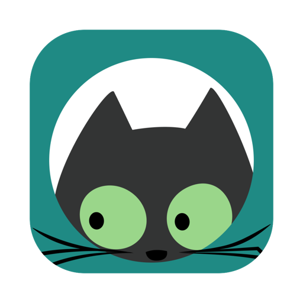
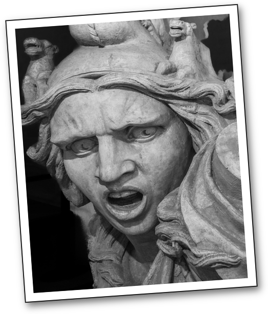

# Stamps

A little cat named Chonke lives in your menu bar. Every so often it peeks in from the edge
of your screen, and its eyes follow your mouse. You can also call it, or slam a "yikes" onto
your screen, whenever the moment calls for it.

## Install

1. Download **Stamps.zip** from the [latest release](https://github.com/aadjones/stamps-app/releases/latest).
2. Unzip it and drag **Stamps** into your Applications folder.
3. Open it. A welcome card shows you the shortcuts, with buttons to try each one.

Needs macOS 13 or newer, on any Mac.

## Shortcuts

| Shortcut | Does |
|---|---|
| **⌥⌘P** | Chonke peeks in |
| **⌥⌘Y** | Yikes |

Chonke also drops by on its own every 20–60 minutes, but only while you're at your Mac.

Yikes lands at a different size each time, sometimes mirrored, and the scream changes speed:

## Menu bar

Click the cat to show a stamp, pause the surprise visits, open Stamps at login, see the
welcome card again, or quit.

## Uninstall

Quit from the menu bar cat, then drag Stamps from Applications to the Trash.
